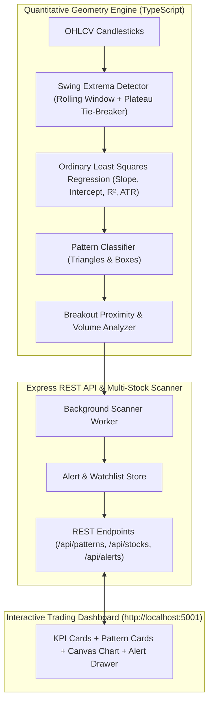

# BullsEye 🎯

> **Automated Stock Market Breakout Pattern Detection, Auto-Trendline Drawing & Early Alert Terminal**

BullsEye is an automated technical analysis and scanning engine built in TypeScript. It eliminates the manual work of scanning hundreds of stock charts by algorithmically identifying classic chart patterns (**Ascending Triangles**, **Descending Triangles**, **Symmetrical Triangles**, and **Box / Darvas Patterns**), calculating real-time breakout proximity, detecting volume surges, auto-drawing upper resistance & lower support trendlines, and triggering early alerts before price breakout occurs.

---

## 🌟 Key Features

1. **Automatic Pattern Recognition**:
   - **Ascending Triangles**: Flat upper resistance ceiling ($|m| \le 2.5\%$), rising lower support ($m \ge 2.5\%$), converging to the right.
   - **Descending Triangles**: Falling upper resistance ($m \le -2.5\%$), flat horizontal support floor.
   - **Symmetrical Triangles**: Falling resistance and rising support meeting at a projected future apex.
   - **Box / Darvas Rectangle Patterns**: Parallel horizontal support and resistance bounding price oscillations.
2. **Breakout Proximity & Early Alerts**:
   - Measures exact percentage distance: $\text{Proximity \%} = \frac{|P_{\text{boundary}} - P_{\text{current}}|}{P_{\text{current}}} \times 100$
   - Categorizes setups into `APPROACHING_BREAKOUT` ($\le 1.5\%$), `AT_BREAKOUT_LEVEL` ($\le 0.4\%$), or `CONFIRMED_BREAKOUT`.
3. **Volume Surge Multiplier**:
   - Computes $\text{Volume Multiplier} = \frac{V_{\text{current}}}{\text{SMA}_{20}(V)}$.
   - Multipliers $\ge 1.5\times$ flag institutional volume confirmation.
4. **Interactive Financial Candlestick Charting**:
   - High-DPI HTML5 Canvas Chart with responsive Retina rendering.
   - **Auto-drawn Upper Resistance Trendline** (Red) and **Lower Support Trendline** (Green).
   - **Dashed Target Breakout Level** (Cyan) with price target tag.
   - **Pivot Touch Highlights** marking the exact candles that formed the pattern.
   - Interactive crosshair and HUD displaying Date, Open, High, Low, Close, and Volume on hover.
5. **Multi-Stock Background Scanner**:
   - Continuously scans watchlist tickers (US Equities, Indian NSE/BSE, Crypto) every 5 minutes or on demand.
6. **Live Alert Drawer & Watchlist Manager**:
   - Slide-over real-time feed of proximity notifications.
   - Add/remove any custom stock ticker on the fly.

---

## 🏗️ Architecture



---

## 🚀 Quick Start

### 1. Installation

```bash
git clone https://github.com/karthick7204/BullsEye.git
cd BullsEye/backend
npm install
```

### 2. Run Algorithmic Unit Tests

Run the complete pattern detection test suite (verifies swing pivot detection, all 4 pattern classifications, and proximity math):

```bash
npx ts-node src/testRunner.ts
```

### 3. Start the Server & Dashboard

```bash
npm run dev
# Or build & start:
npm run build && npm start
```

Open your browser to:
👉 **`http://localhost:5001`**

---

## 📡 REST API Documentation

| Method | Endpoint | Description |
| :--- | :--- | :--- |
| `GET` | `/api/health` | Service health status |
| `GET` | `/api/patterns/active` | All currently active detected patterns across watchlist |
| `GET` | `/api/patterns/scan/:symbol` | On-demand scan of any ticker (returns candles + pattern coordinates) |
| `GET` | `/api/stocks/:symbol/chart` | OHLCV candlesticks formatted for charting |
| `GET` | `/api/scanner/status` | Current scanner status and tracked counts |
| `POST` | `/api/scanner/run` | Manually trigger a full-watchlist refresh scan |
| `GET` | `/api/alerts` | History of recent proximity alerts and confirmed breakouts |
| `POST` | `/api/alerts/clear` | Clear alert history |
| `GET` | `/api/scanner/watchlist` | Retrieve current monitored stock list |
| `POST` | `/api/scanner/watchlist` | Add a ticker symbol to the scanner watchlist |
| `DELETE`| `/api/scanner/watchlist/:symbol` | Remove a ticker from the watchlist |

---

## 🔬 Mathematical Formulas

### 1. Ordinary Least Squares (OLS) Linear Regression
For $N$ swing points $(x_i, y_i)$:
$$m = \frac{N \sum x_i y_i - \sum x_i \sum y_i}{N \sum x_i^2 - (\sum x_i)^2}$$
$$c = \frac{\sum y_i - m \sum x_i}{N}$$
$$R^2 = 1 - \frac{\sum (y_i - (m x_i + c))^2}{\sum (y_i - \bar{y})^2}$$

### 2. Projected Trendline Apex
$$x_{\text{apex}} = \frac{c_{\text{lower}} - c_{\text{upper}}}{m_{\text{upper}} - m_{\text{lower}}}$$
$$y_{\text{apex}} = m_{\text{upper}} \cdot x_{\text{apex}} + c_{\text{upper}}$$

---

## 📄 License
ISC © [karthick7204](https://github.com/karthick7204)
